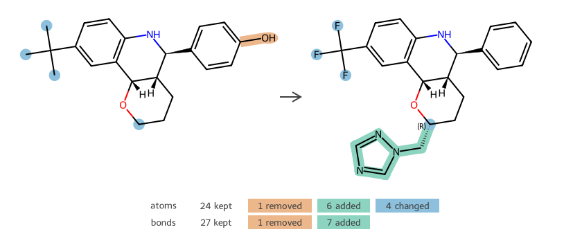

# AtomMapper

Atom mapping of two molecules under the rules of LOMAP's mapping step. Given a source
and a target, it finds which heavy atoms are the same atom, keeping one connected piece
with whole rings and no inverted stereocentre, and it reports the result as a numbered
reaction SMILES, an atom mapping, and the atoms and bonds that change.

<p align="center">
  
</p>

Two ligands of the EG5 series of the protein-ligand benchmark. Kept atoms sit at the same
place in both panels; the hydroxyl leaves, a triazolylmethyl group arrives, the three
methyl carbons of the *tert*-butyl become the fluorines of a trifluoromethyl, and a ring
carbon becomes a stereocentre. The drawing comes from
`atommapper SOURCE TARGET --draw example.png` (see Drawings).

## Install

The search engine is written in Rust, so building from source needs a Rust toolchain
([rustup.rs](https://rustup.rs)):

```bash
git clone https://github.com/craabreu/atommapper.git && cd atommapper
pip install -e .
```

Python 3.11 or later; RDKit, NetworkX and SciPy are installed as dependencies.

## Quick start

```bash
atommapper "Cc1ccc(F)cc1" "Cc1cccc(F)c1"
```

```
[CH3:1][c:6]1[cH:2][cH:4][c:7]([F:8])[cH:5][cH:3]1>>[CH3:1][c:6]1[cH:2][cH:4][cH:7][c:5]([F:9])[cH:3]1
```

Atoms with the same number on both sides are the same atom. A number found on one side
only is an atom that leaves (8, the para fluorine) or arrives (9, the meta fluorine).

In Python:

```python
from atommapper import map_atoms

result = map_atoms("Cc1ccc(F)cc1", "Cc1cccc(F)c1")
result.reaction_smiles   # the numbered source>>target string
result.mapping           # MappedAtom(identifier, source_index, target_index, tag) per kept atom
result.atom_changes      # atoms deleted, inserted, or changed (element, charge, hydrogens, stereo)
result.bond_changes      # bonds deleted, inserted, or changed in order
result.metadata["size"]  # 4: one atom and one bond out, one atom and one bond in
```

`source_index` and `target_index` are atom indices of the inputs as given, which can be
SMILES strings or RDKit molecules.

## Drawings

`--draw FILE` also draws the pair, as SVG or PNG by the file's suffix:

```bash
atommapper "Cc1ccc(F)cc1" "Cc1cccc(F)c1" --draw walk.png --size 400x300
```

The source and the target sit side by side, each panel `--size` pixels, over a legend that
counts what is kept, removed, added and changed, with atoms and bonds in separate rows.

- **Aligned.** Both panels share one scale and one origin, and the target is drawn with its
  kept atoms where the source has them, so a kept atom is at the same place in each panel.
- **Marked.** Light tints under the structure show what leaves (vermillion, on the source),
  what arrives (sky blue, on the target), and which kept atoms and bonds change (yellow, on
  both): element, charge, bond order or stereo. The three colors stay apart under
  deuteranopia, protanopia and tritanopia, and the legend names each one.
- **Stereo.** An inverted centre carries its label on each side, (R) and (S), and an
  inverted double bond (E) and (Z). Every double bond is drawn with the geometry the
  molecule has, even when that moves kept atoms away from the source's positions.
- **Not marked.** A changed hydrogen count, since the bond that forms or breaks at the atom
  already shows it.

`--numbers` labels the kept atoms with their identifiers.

In a notebook, a result displays as this drawing. In Python:

```python
from atommapper import draw_png, draw_svg, map_atoms, save_image

result = map_atoms("Cc1ccc(F)cc1", "Cc1cccc(F)c1")
svg = draw_svg(result, width=400, height=300)  # SVG text
png = draw_png(result, numbers=True)           # PNG bytes, kept atoms numbered
save_image(result, "walk.svg")                 # SVG or PNG by the suffix
```

## The rules

What is kept must satisfy all of these:

- **One piece.** The kept atoms, joined by kept bonds, form one connected piece. Atoms with
  no bond on either side, such as counter-ions, are exempt.
- **Ring to ring.** A ring atom is kept only as a ring atom, and a chain atom only as a
  chain atom.
- **Complete rings.** Every kept ring atom and ring bond lies on a cycle of the kept part:
  a ring is kept whole or not at all, one ring at a time, so a benzene can be kept as one
  ring of a naphthalene. A methylcyclohexane and a methylcyclopentane keep no ring atom.
- **No bond lost between kept atoms.** Two kept atoms bonded on one side are bonded on the
  other, so fused rings are not matched along a different fusion bond. LOMAP checks this
  on the first molecule only; here it is checked on both.
- **No inverted stereo element.** A kept tetrahedral centre keeps its configuration, and so
  does a kept double bond whose neighbours are kept. A centre's hydrogen counts as kept
  with it, so two kept heavy neighbours can already fix the configuration. LOMAP names
  chiral atoms only; this rule leaves no stereo element free.
- **Heavy atoms only.** Hydrogens are not mapped; a changed hydrogen count is a change of
  its atom.

Among the mappings that satisfy the rules, the objective decides:

- `objective="change"` (the default) keeps the smallest change. Each atom or bond present
  on one side only counts one, and so does each kept atom whose element changes and each
  kept bond whose order changes.
- `objective="bonds"` is LOMAP's: the most bonds kept, whatever their orders, then the most
  atoms, then the smallest change.

Ties are broken in a fixed order that reads the same from either molecule: fewer kept
atoms whose heavy-atom neighbours change, then the smaller group moving, then a canonical
order. The mapping of B to A is therefore the reverse of the mapping of A to B.

## Options

```python
map_atoms(source, target, *, element_change=True, objective="change",
          allow_stereo_inversion=False, settings=None)
```

- `element_change=True` (LOMAP's default) lets a kept atom change element, which counts as
  one change; a pyridine and a benzene then keep all six ring atoms. With
  `element_change=False` (`--fixed-elements`), every kept atom keeps its element, and the
  same pair keeps nothing.
- `allow_stereo_inversion=True` (`--allow-stereo-inversion`) lifts the rule against an
  inverted stereo element. A kept centre or double bond may then be inverted, and each
  inversion counts one change. Two molecules that share a core whose centres are mirrored
  can then keep it: in
  `CNC(=O)CN1C[C@]2(C(=O)N(c3cncc4ccccc34)C[C@H]2COC)c2cc(Cl)ccc2C1=O` to
  `C[C@H]1CN(c2cncc3ccccc23)C(=O)[C@@]12CN(CCN1C[C@H]3C[C@@H]1CO3)C(=O)c1ccc(Cl)cc12`,
  15 atoms are kept at a size of 90 without the option and 30 at a size of 28 with it.
- `objective="bonds"` (`--objective bonds`) selects LOMAP's objective (above).
- `settings` takes a `Settings` with the search budgets and limits (below).

## The result

`map_atoms` returns a `MappingResult` with these fields:

- `reaction_smiles`: the source and target as one `source>>target` string. Kept atoms are
  numbered first, in the source's canonical order, then atoms only in the source, then
  atoms only in the target. Hydrogens stay implicit.
- `mapping`: one `MappedAtom` per kept atom. Its tag is `seed` for an atom of a starting
  fragment and `refined` for one added by the search.
- `atom_changes` and `bond_changes`: what differs, by identifier.
- `status`: one of the following.
  - `complete`: every search finished.
  - `timed_out`: a budget or the clock stopped a search, and the result is the best found.
    `reason` says so, and `metadata["budget"]["stopped_by"]` names the limits.
  - `no_common_vertices`: no atom can be kept under the rules.
  - `unsupported_input`: the input holds something the tool does not handle, such as a
    charged hydrogen bonded to a heavy atom.
- `metadata`, a dict that includes:
  - `size`: the size of the change;
  - `cost`: the objective as one number;
  - `kept`: atoms and bonds kept;
  - `optimality`: see Limits;
  - `ambiguity`: how many mappings tie;
  - `stereo`: one verdict per stereo element, such as `retained`, `inverted`, `lost`,
    `gained` or `undetermined`;
  - `checks`: checks the tool ran on its own output, such as whether applying the changes
    to the source gives the target;
  - `budget`, `stage1` and `timings`: how the search went.

`result.reverse()` swaps the two sides without searching again, and `result.to_dict()`
gives the whole result as plain data (`--json` on the command line).

Invalid SMILES raise `InvalidInput`.

## Budgets and the time limit

`Settings` holds the limits of a call:

- **Work budgets.** `stage1_steps` (20 million) bounds the fragment search and
  `node_budget` (1 million) the branch-and-bound. A search stopped by a work budget stops
  at the same point on every machine, so its result is reproducible.
- **Time limit.** `time_limit_s` (60 s) bounds the whole call from its start and is met to
  within tens of milliseconds; parsing and stereo perception are not cut short. A result
  the clock stopped reports `time` among its stop reasons, and it depends on machine speed
  and load.
- **Pair ceiling.** `stage1_bond_pairs` (20,000) caps how many compatible bond pairs the
  fragment search will consider. Very long chains of one element exceed it and come back
  unsearched; raise it to compare them.

The command line takes `--steps`, `--nodes`, `--timeout` and `--pairs`, and exits with
status 3 when a limit stopped the search (0 with `--accept-partial`).

On 3,000 drug-like pairs, one core per call, a call takes 17 ms at the median and 55 ms on
average with elements free (8 s for the slowest pair), and 9 ms and 17 ms with elements
fixed.

## Limits

The search starts from the largest connected fragments the two molecules share and trims
each to the rules. It keeps the largest pieces each trim leaves and grows a mapping around
each piece by branch-and-bound. The pieces themselves are kept whole, so the result is
optimal given its seeds, and `metadata["optimality"]` says `optimal_given_seed`.

The seeds can miss the optimum, and by much. When the largest common fragments break a rule,
the trim cuts them into pieces, and the best mapping may contain none of them. For
example, `NC1Cc2ccccc2CCC1=O` to `N[C@H]1CCc2ccccc2C[C@@H]1O` with elements fixed gets a
size of 21 where 8 is possible.

An inverted stereo element is the common case, and it is seeded for. When a trim drops
atoms for one, the search also starts from each dropped atom paired with every target atom
of its kind.

`Settings(global_budget_s=...)` adds an exact check after the search: the unconstrained
graph edit distance. When it finishes and the result meets it, `optimality` says `optimal`.
The bound ignores the rules, so it proves optimality only when they cost nothing.

This is not OpenFE's LOMAP. It maps no hydrogens and computes no similarity score. Its
stereo rule is stricter. It applies the rules during its search, where LOMAP trims one
maximum common substructure after choosing it.

## Compared with LOMAP

On the free energy networks of the protein-ligand benchmark and on AstraZeneca matched
pairs, AtomMapper finds the same mapping as OpenFE's LOMAP, up to symmetry, for 95-98% of
the pairs where LOMAP's search finished. It is 1.1-2.4 times faster on a typical pair and
has none of LOMAP's slow tail, which runs into its 20 s timeout on 1-3% of the pairs. Unlike
LOMAP, it gives the same mapping whichever molecule comes first.
[benchmarks/README.md](https://github.com/craabreu/atommapper/blob/main/benchmarks/README.md)
has the method, the numbers and where the two disagree.

## How it works

1. **Fragments.** A Rust engine (Koch's algorithm on the bond-pair compatibility graph)
   lists the largest connected common fragments, and those whose largest piece keeps the
   most bonds once trimmed to complete rings. With elements free, it searches on ring and
   chain labels and on element labels too.
2. **Seeds.** Each fragment is trimmed to the rules, and the largest pieces left become
   seeds, deduplicated by symmetry.
3. **Search.** From each seed, a branch-and-bound adds atoms only across kept bonds, so the
   kept part stays one piece. A lower bound that reads how that piece can still grow cuts
   most branches, and every recorded mapping is checked against the rules.
4. **Choice.** The cheapest mapping over all seeds wins, with ties broken as above.

## Development

```bash
make format   # ruff and cargo fmt
make check    # ruff, ty, cargo fmt and clippy, the Rust tests, a rebuild, pytest
```

AtomMapper was extracted from moldelta, a molecule-diff tool, where this mapping was
`lomap_map`.

## License

MIT; see [LICENSE](LICENSE).
