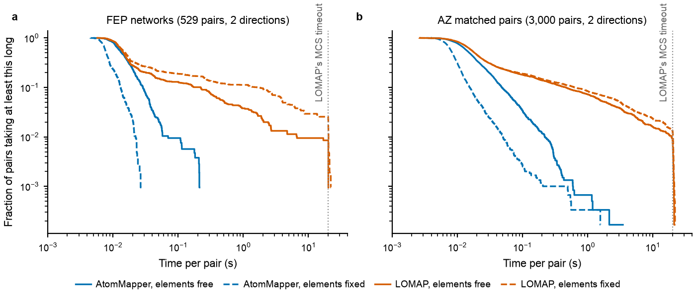

# Benchmark: AtomMapper vs. OpenFE's LOMAP mapping step

Across 529 free-energy network edges and 3,000 AstraZeneca matched molecular pairs,
**AtomMapper used 17–102× less total mapping time** than LOMAP's mapping step. The main
advantage was avoiding the small number of very slow LOMAP searches. Median per-pair
speedups were more modest: **1.1–2.3×**.

With `objective="bonds"`, AtomMapper agreed with LOMAP on **95–98% of completed LOMAP
mappings**, up to symmetry. AtomMapper finished all tested pairs within its default
budgets and returned equivalent mappings in both directions.

These are measurements of **pairwise mapping**, not an end-to-end comparison of OpenFE,
network planning, or similarity scoring. The results below describe this dataset,
hardware, and software configuration; they are not a speed or quality guarantee for
other molecules. See the [main README](../README.md) for installation and usage.

## Timing at a glance

| Dataset | Element changes | Directed mappings | AtomMapper total | LOMAP total |
|---|---|---:|---:|---:|
| FEP networks | Allowed | 1,058 | 19 s | 322 s |
| FEP networks | Forbidden | 1,058 | 9 s | 967 s |
| AZ matched pairs | Allowed | 6,000 | 190 s | 3,223 s |
| AZ matched pairs | Forbidden | 6,000 | 68 s | 4,218 s |

Totals are **sums of per-call wall-clock times**, including timed-out calls, for both
source-to-target and target-to-source mappings. They are not the elapsed time of the
32-worker benchmark job. Times are rounded to whole seconds; the reported 17–102× range
uses the underlying timings. AtomMapper timings refer to its default `"change"`
objective; the `"bonds"` timings were similar (see below).

## Methods compared

- **LOMAP**: `lomap.mcs.MCS` (LOMAP 3.3.0) with its defaults: 2D and a 20 s timeout on
  each MCS search. Its input is the molecule from SMILES with hydrogens added and 2D
  coordinates; its output is the heavy-atom map. Scoring is not run.
- **AtomMapper (change)**: `map_atoms` with its default objective, the smallest change.
- **AtomMapper (bonds)**: `map_atoms(objective="bonds")`, LOMAP's objective: the most
  bonds kept, then the most atoms, then the smallest change.

The script `compare_lomap.py` runs each method in the same worker, one after another.
It evaluates every output with AtomMapper's code: retained atoms and bonds, change size,
and violations of AtomMapper's stated mapping constraints. These checks are not an
independent assessment of suitability for a free-energy calculation.

Each method runs with elements free (element changes allowed, LOMAP's default
`element_change=True`) and with elements fixed (element changes forbidden). Every pair is
mapped in both directions, source to target and target to source, since LOMAP's answer
can depend on which molecule comes first. Times are wall clock
for the whole call from canonical SMILES strings, including parsing, LOMAP's hydrogen
addition and 2D coordinate generation, and AtomMapper's result assembly. Shared input
canonicalization and post-call evaluation are outside the timed region. Each worker
imports LOMAP and maps one small pair with both tools before its first timed call, so
no time includes an import.

## Pairs

- **FEP networks** (529 pairs): the edges of the networks OpenFE's LOMAP planner built on
  the 15 targets of the [protein-ligand benchmark](https://github.com/openforcefield/protein-ligand-benchmark)
  (MIT license), the pairs a relative binding free energy study would run.
  `fep_pairs.py OUT.csv` downloads the source files at commit
  `fd88824f9114244f95a14b485e6d6c96c1de716d` and writes the pairs; internet access is
  required. `--all` writes every pair within each target instead (5,084 pairs), which is
  a different benchmark from the one reported here.
- **AZ matched pairs** (3,000 pairs): a fixed random sample of the AstraZeneca matched
  molecular pairs on [Zenodo, record 6319821](https://zenodo.org/records/6319821),
  more varied than a congeneric series. `az_pairs.py AZ_CSV OUT.csv` draws the sample
  from the deposit with `--n 3000 --seed 20261106`. The input CSV must have `Source_Mol`
  and `Target_Mol` columns; keep the same input file and row order to reproduce the sample.

## Results

Run on 2026-11-16 on an AMD Ryzen Threadripper PRO 5975WX (32 cores, 64 threads) with 32
workers, Python 3.12, RDKit 2026.03.6, LOMAP 3.3.0 and AtomMapper 0.1.0. No method failed
on any pair. Each result below counts both directions, so each pair counts twice.
The two AtomMapper objectives had similar timings, with per-mapping differences of at
most 0.35 s in this run. The figure shows the default `"change"` objective.

### Time per pair



Half of LOMAP's total mapping time went to its slowest 0.8–2.3% of mappings, each
taking at least 14 s. Calls longer than one second accounted for 85–96% of its total time,
while representing only 4–11% of mappings. This slow tail explains why the aggregate
speedup is much larger than the median speedup.

Calls in which an MCS search reached LOMAP's 20 s timeout accounted for 34–57% of its
total time: 9 and 27 of the 1,058 FEP mappings (elements free and fixed), and 54 and 81
of the 6,000 AZ mappings. The timeout applies to each MCS search, not necessarily to
the entire LOMAP call. AtomMapper's longest call in this benchmark was 3.6 s.

### Mappings

The mappings are compared only where LOMAP's MCS search finished. When it times out, LOMAP
goes on with the MCS found by then, which depends on the machine's speed and load.
`compare_lomap.py timeouts` maps the 171 timed-out cases again with other timeouts: at 5 s
instead of 20 s, LOMAP's mapping changes in 1 case, and at 60 s in 13, each time keeping
more bonds, while 74 cases still time out. This tests sensitivity to the time budget; it
is not a direct measurement on slower or faster hardware. AtomMapper finished every pair
within its work budgets and its default 60 s limit, so no result in this run was selected
by a wall-clock cutoff.

| | FEP, free | FEP, fixed | AZ, free | AZ, fixed |
|---|---|---|---|---|
| mappings compared (both directions) | 1,049 | 1,031 | 5,946 | 5,919 |
| same mapping as LOMAP, up to symmetry (bonds) | 98.1% | 95.9% | 95.3% | 96.2% |
| more bonds kept than LOMAP (bonds) | 0 | 1 | 20 | 2 |
| fewer bonds kept than LOMAP (bonds) | 0 | 0 | 14 | 15 |
| smaller change than LOMAP (change) | 2 | 11 | 133 | 68 |
| larger change than LOMAP (change) | 0 | 0 | 14 | 15 |
| LOMAP's mapping inverts a stereo element | 0 | 0 | 30 | 27 |

- **Where AtomMapper keeps more bonds** (23 mappings), LOMAP lost bonds when it trimmed
  the MCS it had chosen to its rules: on each of them RDKit's MCS has at least as many bonds
  as AtomMapper's mapping, and LOMAP's trimmed mapping fewer. AtomMapper applies the rules
  during its search.
- **Where AtomMapper keeps fewer bonds** (14 and 15 AZ mappings), LOMAP's mapping keeps a
  stereo element inverted every time, as AtomMapper judges it. LOMAP's own check compares a
  centre's neighbours within its heavy-atom match only, so it can miss an inversion, for
  instance one that the centre's hydrogen decides (see
  [mapping constraints](../README.md#mapping-constraints)). Among the completed LOMAP
  mappings that satisfy these constraints **in this benchmark**, AtomMapper never keeps
  fewer bonds than LOMAP. This is an empirical result, not an optimality guarantee.
- **Where AtomMapper makes a smaller change**, it mostly keeps the same bonds as LOMAP
  (2 of 2, 10 of 11, 113 of 133 and 66 of 68 mappings): LOMAP chose among mappings that
  keep as many bonds without looking at the change. In the others it keeps more bonds too.
- No mapping by either tool breaks the other rules: one piece, complete rings, no bond
  lost between kept atoms.

"Same mapping, up to symmetry" means the same pairs of symmetry classes (RDKit canonical
ranks without tie-breaking); in principle two mappings can share them without being related
by a symmetry of the molecules. An isomorphism check of 6,451 of the cases, made outside
these scripts, found none, here or in the symmetry table below.

### Symmetry

Mapping B to A should give the reverse of mapping A to B. On the pairs where no run was
stopped by the clock, the two directions give:

| | LOMAP: different bonds kept | LOMAP: different mapping | AtomMapper: either |
|---|---|---|---|
| FEP, elements free | 0 of 524 | 4 (0.8%) | 0 of 529 |
| FEP, elements fixed | 1 of 515 | 6 (1.2%) | 0 of 529 |
| AZ, elements free | 0 of 2,970 | 13 (0.4%) | 0 of 3,000 |
| AZ, elements fixed | 1 of 2,956 | 22 (0.7%) | 0 of 3,000 |

AtomMapper returns the reverse mapping, up to symmetry, on every pair of the benchmark, with
either objective. Where LOMAP's two directions differ, they mostly keep the same bonds and choose
another of the tied mappings; on two pairs one direction keeps fewer bonds.

## Reproducing the benchmarks

Run these commands from a checkout of this repository, using an environment with
AtomMapper installed. The scripts are repository utilities, not installed CLI commands.
For a source installation, follow the [development instructions](../README.md#development).
Install the additional benchmark dependencies:

```bash
python -m pip install "lomap2==3.3.0" pyyaml matplotlib
```

For comparable results, also match the Python and RDKit versions listed above and record
the AtomMapper commit. Adjust `--workers` for your machine; simultaneous workers can
change per-call timings. Use `--limit 10` on both forward and reverse runs for a smoke
test before running a full dataset.

### FEP network pairs

```bash
python benchmarks/fep_pairs.py fep.csv
python benchmarks/compare_lomap.py run fep.csv fep.jsonl --workers 32
python benchmarks/compare_lomap.py run fep.csv fep_reverse.jsonl --workers 32 --reverse
python benchmarks/compare_lomap.py summary fep.jsonl fep_reverse.jsonl
python benchmarks/compare_lomap.py symmetry fep.jsonl fep_reverse.jsonl
```

### AstraZeneca matched pairs

Download the CSV with `Source_Mol` and `Target_Mol` columns from the
[Zenodo deposit](https://zenodo.org/records/6319821), then replace `AZ_CSV` below with its
local path. The sampling script does not download the deposit.

```bash
python benchmarks/az_pairs.py AZ_CSV az.csv --n 3000 --seed 20261106
python benchmarks/compare_lomap.py run az.csv az.jsonl --workers 32
python benchmarks/compare_lomap.py run az.csv az_reverse.jsonl --workers 32 --reverse
python benchmarks/compare_lomap.py summary az.jsonl az_reverse.jsonl
python benchmarks/compare_lomap.py symmetry az.jsonl az_reverse.jsonl
```

### Plotting and timeout sensitivity

Once both datasets have been run in both directions:

```bash
python benchmarks/plot_timing.py \
    fep.jsonl,fep_reverse.jsonl az.jsonl,az_reverse.jsonl benchmarks/timing

python benchmarks/compare_lomap.py timeouts fep.csv fep.jsonl fep_reverse.jsonl \
    --limits 5 60 --workers 32
python benchmarks/compare_lomap.py timeouts az.csv az.jsonl az_reverse.jsonl \
    --limits 5 60 --workers 32
```

The plot command writes `benchmarks/timing.png`. `summary` prints Markdown tables; `symmetry` compares the two directions; `timeouts` reruns only
LOMAP cases that originally timed out. Keep each JSONL file with its original pair CSV:
records refer to row indices, and the timeout analysis needs the same row order.

### Your own molecule pairs

Supply a CSV with `source` and `target` SMILES columns and an optional `group` column:

```csv
group,source,target
example,CCO,CC=O
example,Cc1ccc(F)cc1,Cc1cccc(F)c1
```

```bash
python benchmarks/compare_lomap.py run pairs.csv results.jsonl --workers 1
python benchmarks/compare_lomap.py summary results.jsonl
```

Each row produces one JSONL record containing timings, errors, timeout indicators, kept
counts, change sizes, constraint checks, and symmetry keys for all six method/element-mode
combinations. Drawing and the post-call comparison checks are excluded from mapping times.
